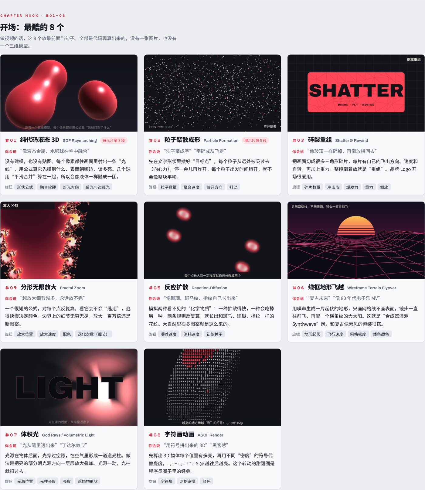

# 50 Style of MG · MG 技法图鉴

**看得懂，说不出？** 这是一本给门外汉的 Motion Graphics 技法图鉴：50 个技法，每个都有一段循环小动画、一句“你平时会怎么形容它”、它的真名，以及能调的旋钮。

以后想要某种画面，不用再从头形容它长什么样，直接对 AI 说“开场用 #02，结尾用 #43”就行。

*A field guide to 50 motion-graphics techniques, each with a live looping demo, a plain-language description, and the knobs you can turn. Use the numbers as a shared vocabulary when you prompt an AI.*

## 怎么用

1. 下载这个仓库，双击打开 `index.html`（不用装任何东西，浏览器就能看）。
2. 看中哪个效果，记下卡片名字前面的编号。
3. 按这个公式写提示词：

> **编号（名字） + 旋钮（数字） + 感觉（比喻）**

两个完整的改写示范在 [prompts/描述示范.md](prompts/描述示范.md)。

## 50 个技法

| 章节 | 编号 | 内容 |
| --- | --- | --- |
| 开场：最酷的 8 个 | #01–08 | 纯代码液态 3D、粒子聚散成形、碎裂重组、分形无限放大、反应扩散、线框地形飞越、体积光、字符画动画 |
| A 手感：东西怎么动 | #09–16 | 缓动、挤压拉伸、预备动作、跟随与重叠、错峰入场、弹簧物理、拖尾与运动模糊、节拍卡点 |
| B 形状与线 | #17–23 | 路径描边、形状变形、遮罩揭示、液态融合、谐波线、程序化生长、万花筒 |
| C 文字 | #24–26 | 动态排版、乱码解码、路径文字 |
| D 粒子、场与物理 | #27–30 | 噪声流场、爆散与重力、吸引与排斥、布料模拟 |
| E 空间与镜头 | #31–37 | 透视与正交、点云、等距视角、视差、无限缩放、景深与拉焦、镜头运动（移 / 摇 / 推 / 变焦） |
| F 质感 | #38–42 | 故障艺术、辉光、半调网点、像素化与抖动、胶片颗粒与暗角 |
| G 转场 | #43–46 | 形变转场、形状擦除、推挤转场、快切蒙太奇 |
| H 版式与包装 | #47–50 | 瑞士网格、界面装饰、斜置屏幕包装、声音可视化 |

所有动画都是网页里用代码实时画出来的，没有一张图片，也没有一个三维模型。#01 和 #04 会用显卡计算，没有显卡加速的设备会自动换成简化版。

## 案例：一段提示词做出 16 秒片头

[case/](case/) 里是一个完整案例：把 5 个技法（#06 线框地形飞越 → #02 粒子聚散成形 → #38 故障艺术 → #10 挤压拉伸 + #43 形变转场 → #25 乱码解码）缝成一条带配乐的 16 秒频道片头。

- [case/PROMPT.md](case/PROMPT.md)：整体提示词。把文字换成你自己的，复制给会写代码的 AI 就能复现。
- [case/index.html](case/index.html)：一个没看过任何上下文的 AI，只读这段提示词做出来的成品，打开点播放。
- [case/case.mp4](case/case.mp4)：导出的视频。

## 出品

娜乌斯嘉AI 和她的 AI 搭档克肆（Claude Opus 5.5）一起做的。

MIT 协议，随便用，记得注明出处。
